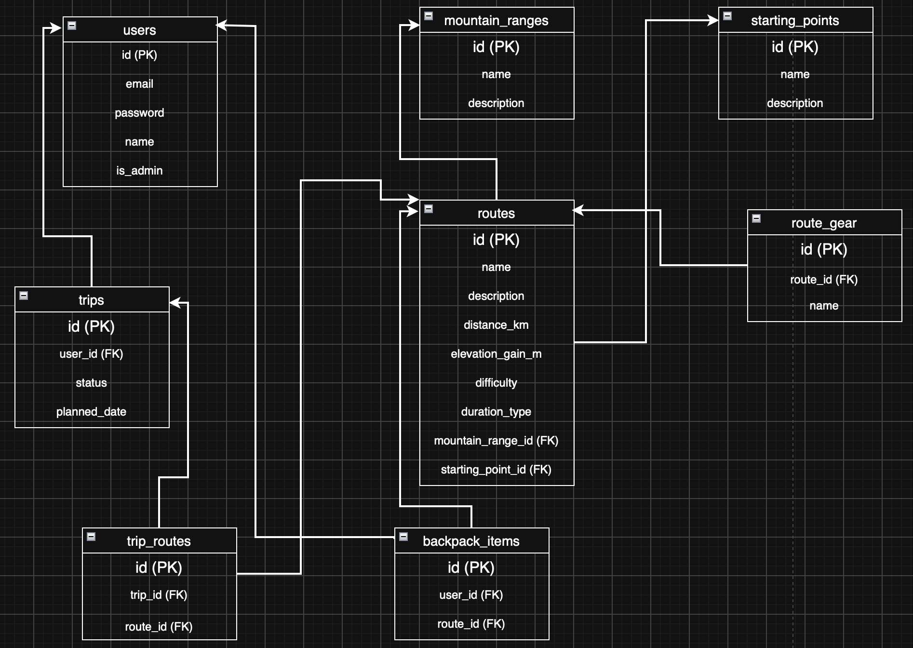

# Плай

Сайт для любителів хайкінгу та гірських походів у Карпатах. 
Він допомагає знайти маршрут, оцінити його складність і запланувати похід.

Користувач може переглядати каталог маршрутів і шукати їх за назвою вершини чи маршруту. 
Результати можна фільтрувати за складністю та тривалістю (одноденний чи з ночівлею) і 
сортувати за кілометражем, набором висоти чи популярністю. На сторінці маршруту є детальний опис, кілометраж, 
перепад висот і список необхідних речей, які варто взяти з собою.

Маршрути згруповані за гірськими масивами (Чорногора, Ґорґани, Мармароси, Свидовець тощо) 
і за стартовими селами/населеними пунктами (Дземброня, Кваси, Ворохта, Ясіня тощо). 
Можна відкрити масив або село і побачити всі пов'язані з ними маршрути.

Зареєстрований користувач додає маршрути до свого «рюкзака», а потім планує похід. 
Усі заплановані та пройдені походи зберігаються в профілі, який можна редагувати.

Адміністратор може додавати, змінювати й видаляти маршрути, масиви та стартові локації.

Окрема сторінка «Про нас» містить контакти, правила безпеки в горах і поради зі спорядження.

## Як запустити проєкт

Для локального запуску бекенду виконайте наступні кроки у терміналі:

1. Створіть та активуйте віртуальне середовище:

   ```bash
   python -m venv .venv
   source .venv/bin/activate
   ```

2. Встановіть необхідні залежності:

   ```bash
   pip install -r requirements.txt
   ```

3. Застосуйте міграції бази даних:

   ```bash
   python manage.py migrate
   ```

4. Створіть адміністратора (потрібен для створення, редагування й видалення даних):

   ```bash
   python manage.py createsuperuser
   ```

5. Запустіть сервер:

   ```bash
   python manage.py runserver
   ```

Бекенд працюватиме за адресою: http://127.0.0.1:8000/.

## Ендпоінти

### Авторизація та права доступу

Захищені ендпоінти потребують access токена в заголовку:

```
Authorization: Bearer <access_token>
```

Токен отримують через `POST /api/v1/auth/login/`. Access токен діє 5 хвилин, refresh токен 1 день. Коли access токен закінчується, новий отримують через `POST /api/v1/auth/refresh/`, не вводячи пароль знову.

| Дія | Хто має доступ |
|---|---|
| Перегляд маршрутів, масивів і стартових пунктів (`GET`) | усі, токен не потрібен |
| Створення, редагування, видалення маршрутів, масивів і стартових пунктів (`POST`, `PATCH`, `DELETE`) | лише адміністратор |
| Реєстрація, логін, оновлення токена | усі |

### Формат помилок

Усі помилки API повертаються в єдиному форматі.

`400 Bad Request` (невалідні дані, повідомлення для кожного поля):

```json
{
  "error": "Невалідні дані",
  "details": {
    "name": ["Це поле обов'язкове."]
  }
}
```

`401 Unauthorized` (немає токена, токен недійсний або прострочений):

```json
{
  "error": "Потрібна авторизація. Увійдіть в акаунт і передайте access токен у заголовку Authorization: Bearer <token>"
}
```

`403 Forbidden` (користувач авторизований, але не адміністратор):

```json
{
  "error": "Недостатньо прав для виконання цієї дії. Потрібні права адміністратора"
}
```

`404 Not Found` (об'єкта не існує):

```json
{
  "error": "Маршрут не знайдено"
}
```

`409 Conflict` (видалення масиву чи стартового пункту, до якого прив'язані маршрути):

```json
{
  "error": "Неможливо видалити гірський масив, оскільки існують пов'язані маршрути"
}
```

### Маршрути

#### Отримати список маршрутів

**Опис:** Повертає список усіх маршрутів. **TODO:** пошук, фільтри, сортування та пагінація ще не реалізовані.

**Метод:** `GET /api/v1/routes/`

**Доступ:** усі.

**Статус відповіді:** `200 OK`

**Тіло відповіді:**

```json
[
  {
    "id": 1,
    "name": "Говерла з Заросляка",
    "description": "Класичний підйом на найвищу вершину України...",
    "distance_km": 12.5,
    "elevation_gain_m": 1050,
    "difficulty": "medium",
    "duration_type": "one_day",
    "mountain_range": 1,
    "starting_point": 1,
    "gear": ["трекінгове взуття", "дощовик", "вода 1.5 л"]
  }
]
```

#### Отримати один маршрут

**Опис:** Повертає повну інформацію про маршрут для його сторінки.

**Метод:** `GET /api/v1/routes/{id}/`

**Доступ:** усі.

**Статус відповіді:** `200 OK`

**Тіло відповіді:**

```json
{
  "id": 1,
  "name": "Говерла з Заросляка",
  "description": "Класичний підйом на найвищу вершину України...",
  "distance_km": 12.5,
  "elevation_gain_m": 1050,
  "difficulty": "medium",
  "duration_type": "one_day",
  "mountain_range": 1,
  "starting_point": 1,
  "gear": ["трекінгове взуття", "дощовик", "вода 1.5 л"]
}
```

**Помилки:** `404`.

#### Створити маршрут

**Опис:** Додає новий маршрут.

**Метод:** `POST /api/v1/routes/`

**Доступ:** лише адміністратор.

**Тіло запиту:**

```json
{
  "name": "Говерла з Заросляка",
  "description": "Класичний підйом на найвищу вершину України...",
  "distance_km": 12.5,
  "elevation_gain_m": 1050,
  "difficulty": "medium",
  "duration_type": "one_day",
  "gear": ["трекінгове взуття", "дощовик", "вода 1.5 л"],
  "mountain_range": 1,
  "starting_point": 1
}
```

**Статус відповіді:** `201 Created`

**Тіло відповіді:** створений маршрут у тому ж форматі, що й у «Отримати один маршрут».

**Помилки:** `400`, `401`, `403`.

#### Оновити маршрут

**Опис:** Змінює вказані поля маршруту.

**Метод:** `PATCH /api/v1/routes/{id}/`

**Доступ:** лише адміністратор.

**Тіло запиту** (лише ті поля, які змінюються):

```json
{
  "difficulty": "hard"
}
```

**Статус відповіді:** `200 OK`

**Тіло відповіді:** оновлений маршрут у тому ж форматі, що й у «Отримати один маршрут».

**Помилки:** `400`, `401`, `403`, `404`.

#### Видалити маршрут

**Опис:** Видаляє маршрут.

**Метод:** `DELETE /api/v1/routes/{id}/`

**Доступ:** лише адміністратор.

**Статус відповіді:** `204 No Content`

**Тіло відповіді:** немає.

**Помилки:** `401`, `403`, `404`.

### Гірські масиви

#### Отримати список гірських масивів

**Опис:** Повертає всі гірські масиви (Чорногора, Ґорґани тощо).

**Метод:** `GET /api/v1/mountain-ranges/`

**Доступ:** усі.

**Статус відповіді:** `200 OK`

**Тіло відповіді:**

```json
[
  {
    "id": 1,
    "name": "Чорногора",
    "description": "Найвищий гірський масив Українських Карпат..."
  }
]
```

#### Отримати один гірський масив

**Опис:** Повертає інформацію про масив для його сторінки.

**Метод:** `GET /api/v1/mountain-ranges/{id}/`

**Доступ:** усі.

**Статус відповіді:** `200 OK`

**Тіло відповіді:**

```json
{
  "id": 1,
  "name": "Чорногора",
  "description": "Найвищий гірський масив Українських Карпат..."
}
```

**Помилки:** `404`.

#### Отримати маршрути гірського масиву

**Опис:** Повертає всі маршрути, які пролягають через цей масив.

**Метод:** `GET /api/v1/mountain-ranges/{id}/routes/`

**Доступ:** усі.

**Статус відповіді:** `200 OK`

**Тіло відповіді:** масив маршрутів у тому ж форматі, що й у «Отримати список маршрутів».

**Помилки:** `404`.

#### Створити гірський масив

**Опис:** Додає новий гірський масив.

**Метод:** `POST /api/v1/mountain-ranges/`

**Доступ:** лише адміністратор.

**Тіло запиту:**

```json
{
  "name": "Чорногора",
  "description": "Найвищий гірський масив Українських Карпат..."
}
```

**Статус відповіді:** `201 Created`

**Тіло відповіді:** створений масив у тому ж форматі, що й у «Отримати один гірський масив».

**Помилки:** `400`, `401`, `403`.

#### Оновити гірський масив

**Опис:** Змінює вказані поля масиву.

**Метод:** `PATCH /api/v1/mountain-ranges/{id}/`

**Доступ:** лише адміністратор.

**Тіло запиту** (лише ті поля, які змінюються):

```json
{
  "description": "Новий опис масиву"
}
```

**Статус відповіді:** `200 OK`

**Тіло відповіді:** оновлений масив у тому ж форматі, що й у «Отримати один гірський масив».

**Помилки:** `400`, `401`, `403`, `404`.

#### Видалити гірський масив

**Опис:** Видаляє масив. Якщо до масиву прив'язані маршрути, видалення заборонене.

**Метод:** `DELETE /api/v1/mountain-ranges/{id}/`

**Доступ:** лише адміністратор.

**Статус відповіді:** `204 No Content`

**Тіло відповіді:** немає.

**Помилки:** `401`, `403`, `404`, `409`.

### Стартові населені пункти

#### Отримати список стартових пунктів

**Опис:** Повертає всі населені пункти, з яких починаються маршрути (Дземброня, Ворохта тощо).

**Метод:** `GET /api/v1/starting-points/`

**Доступ:** усі.

**Статус відповіді:** `200 OK`

**Тіло відповіді:**

```json
[
  {
    "id": 1,
    "name": "Ворохта",
    "description": "Селище в Івано-Франківській області, відправна точка багатьох маршрутів..."
  }
]
```

#### Отримати один стартовий пункт

**Опис:** Повертає інформацію про населений пункт для його сторінки.

**Метод:** `GET /api/v1/starting-points/{id}/`

**Доступ:** усі.

**Статус відповіді:** `200 OK`

**Тіло відповіді:**

```json
{
  "id": 1,
  "name": "Ворохта",
  "description": "Селище в Івано-Франківській області, відправна точка багатьох маршрутів..."
}
```

**Помилки:** `404`.

#### Отримати маршрути зі стартового пункту

**Опис:** Повертає всі маршрути, які починаються в цьому населеному пункті.

**Метод:** `GET /api/v1/starting-points/{id}/routes/`

**Доступ:** усі.

**Статус відповіді:** `200 OK`

**Тіло відповіді:** масив маршрутів у тому ж форматі, що й у «Отримати список маршрутів».

**Помилки:** `404`.

#### Створити стартовий пункт

**Опис:** Додає новий стартовий населений пункт.

**Метод:** `POST /api/v1/starting-points/`

**Доступ:** лише адміністратор.

**Тіло запиту:**

```json
{
  "name": "Ворохта",
  "description": "Селище в Івано-Франківській області, відправна точка багатьох маршрутів..."
}
```

**Статус відповіді:** `201 Created`

**Тіло відповіді:** створений пункт у тому ж форматі, що й у «Отримати один стартовий пункт».

**Помилки:** `400`, `401`, `403`.

#### Оновити стартовий пункт

**Опис:** Змінює вказані поля стартового пункту.

**Метод:** `PATCH /api/v1/starting-points/{id}/`

**Доступ:** лише адміністратор.

**Тіло запиту** (лише ті поля, які змінюються):

```json
{
  "description": "Новий опис населеного пункту"
}
```

**Статус відповіді:** `200 OK`

**Тіло відповіді:** оновлений пункт у тому ж форматі, що й у «Отримати один стартовий пункт».

**Помилки:** `400`, `401`, `403`, `404`.

#### Видалити стартовий пункт

**Опис:** Видаляє стартовий пункт. Якщо від пункту починаються маршрути, видалення заборонене.

**Метод:** `DELETE /api/v1/starting-points/{id}/`

**Доступ:** лише адміністратор.

**Статус відповіді:** `204 No Content`

**Тіло відповіді:** немає.

**Помилки:** `401`, `403`, `404`, `409`.

### Автентифікація

#### Зареєструватися

**Опис:** Створює акаунт нового користувача. Пароль зберігається в захешованому вигляді.

**Метод:** `POST /api/v1/auth/register/`

**Доступ:** усі.

**Тіло запиту:**

| Поле | Обов'язкове | Опис |
|---|---|---|
| `username` | так | унікальне ім'я користувача |
| `first_name` | ні | ім'я |
| `last_name` | ні | прізвище |
| `email` | так | коректна адреса, унікальна |
| `password` | так | не менше 8 символів, не надто проста |
| `password_confirmation` | так | має збігатися з `password` |

```json
{
  "username": "daria",
  "first_name": "Дарʼя",
  "last_name": "Синявська",
  "email": "daria@example.com",
  "password": "Hiker-Pass-2027",
  "password_confirmation": "Hiker-Pass-2027"
}
```

**Статус відповіді:** `201 Created`

**Тіло відповіді:**

```json
{
  "id": 1,
  "username": "daria",
  "first_name": "Дарʼя",
  "last_name": "Синявська",
  "email": "daria@example.com"
}
```

**Помилки:** `400` (повідомлення для кожного некоректного поля), наприклад:

```json
{
  "error": "Невалідні дані",
  "details": {
    "password_confirmation": ["Паролі не збігаються"]
  }
}
```

#### Увійти

**Опис:** Перевіряє username і пароль та повертає пару токенів.

**Метод:** `POST /api/v1/auth/login/`

**Доступ:** усі.

**Тіло запиту:**

```json
{
  "username": "daria",
  "password": "Hiker-Pass-2027"
}
```

**Статус відповіді:** `200 OK`

**Тіло відповіді:**

```json
{
  "refresh": "<refresh_token>",
  "access": "<access_token>"
}
```

**Помилки:** `401`, якщо username або пароль невірні:

```json
{
  "error": "Невірний username або пароль"
}
```

#### Оновити access токен

**Опис:** Видає новий access токен за refresh токеном, без повторного введення пароля.

**Метод:** `POST /api/v1/auth/refresh/`

**Доступ:** усі.

**Тіло запиту:**

```json
{
  "refresh": "<refresh_token>"
}
```

**Статус відповіді:** `200 OK`

**Тіло відповіді:**

```json
{
  "access": "<access_token>"
}
```

**Помилки:** `401`, якщо refresh токен недійсний або прострочений:

```json
{
  "error": "Токен недійсний або термін його дії закінчився. Оновіть токен або увійдіть знову"
}
```

#### Вийти

Окремого ендпоінта немає: при виході клієнт видаляє збережені `access` і `refresh` токени.

### Профіль

Ендпоінти цього розділу доступні лише авторизованому користувачу.

#### Отримати свій профіль

**Опис:** Повертає дані поточного користувача.

**Метод:** `GET /api/v1/users/me/`

**Статус відповіді:** `200 OK`

**Тіло відповіді:**

```json
{
  "id": 1,
  "username": "daria",
  "first_name": "Дарʼя",
  "last_name": "Синявська",
  "email": "daria@example.com",
  "is_staff": false
}
```

#### Редагувати свій профіль

**Опис:** Змінює вказані дані поточного користувача.

**Метод:** `PATCH /api/v1/users/me/`

**Статус:** ще не реалізовано.

**Тіло запиту** (лише ті поля, які змінюються):

```json
{
  "first_name": "Дарʼя С."
}
```

**Статус відповіді:** `200 OK`

**Тіло відповіді:** оновлений профіль у тому ж форматі, що й у «Отримати свій профіль».

### Рюкзак

**Статус:** ще не реалізовано.

Ендпоінти цього розділу доступні лише авторизованому користувачу.

#### Отримати вміст рюкзака

**Опис:** Повертає маршрути, які користувач додав до свого рюкзака.

**Метод:** `GET /api/v1/backpack/`

**Статус відповіді:** `200 OK`

**Тіло відповіді:** масив маршрутів у тому ж форматі, що й у «Отримати список маршрутів».

#### Додати маршрут до рюкзака

**Опис:** Кладе обраний маршрут до рюкзака.

**Метод:** `POST /api/v1/backpack/items/`

**Тіло запиту:**

```json
{
  "route_id": 1
}
```

**Статус відповіді:** `201 Created`

**Тіло відповіді:** немає.

#### Прибрати маршрут з рюкзака

**Опис:** Видаляє маршрут з рюкзака.

**Метод:** `DELETE /api/v1/backpack/items/{route_id}/`

**Статус відповіді:** `204 No Content`

**Тіло відповіді:** немає.

### Походи

**Статус:** ще не реалізовано.

Ендпоінти цього розділу доступні лише авторизованому користувачу.

#### Запланувати похід

**Опис:** Створює похід з маршрутів, які лежать у рюкзаку. Після цього рюкзак очищається.

**Метод:** `POST /api/v1/trips/`

**Тіло запиту:**

```json
{
  "planned_date": "2027-07-15"
}
```

**Статус відповіді:** `201 Created`

**Тіло відповіді:**

```json
{
  "id": 5,
  "status": "planned",
  "planned_date": "2027-07-15",
  "routes": [
    {
      "id": 1,
      "name": "Говерла з Заросляка"
    }
  ]
}
```

#### Отримати історію походів

**Опис:** Повертає заплановані та пройдені походи поточного користувача.

**Метод:** `GET /api/v1/trips/`

**Параметри (необов'язкові):**

| Параметр | Опис |
|---|---|
| `status` | `planned` / `completed` |

**Статус відповіді:** `200 OK`

**Тіло відповіді:** масив походів у тому ж форматі, що й у «Запланувати похід».

#### Позначити похід пройденим

**Опис:** Змінює статус запланованого походу на пройдений.

**Метод:** `PATCH /api/v1/trips/{id}/`

**Тіло запиту:**

```json
{
  "status": "completed"
}
```

**Статус відповіді:** `200 OK`

**Тіло відповіді:** оновлений похід у тому ж форматі, що й у «Запланувати похід».

### Про нас

**Статус:** ще не реалізовано.

#### Отримати інформацію «Про нас»

**Опис:** Повертає контакти, правила безпеки в горах і поради зі спорядження для сторінки «Про нас».

**Метод:** `GET /api/v1/about/`

**Статус відповіді:** `200 OK`

**Тіло відповіді:**

```json
{
  "contacts": {
    "email": "info@plai.example",
    "phone": "+380000000000"
  },
  "safety_rules": [
    "Повідомте рятувальників про свій маршрут перед виходом",
    "Перевіряйте прогноз погоди",
    "Номер екстреної допомоги: 112"
  ],
  "gear_tips": [
    "Беріть трекінгове взуття",
    "Майте дощовик навіть у ясну погоду"
  ]
}
```

## Схема бази даних


