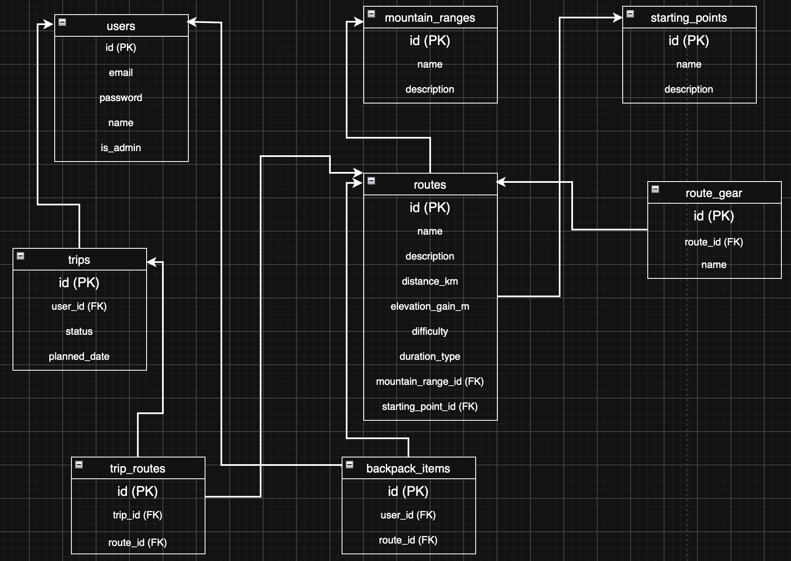

# Плай

Сайт для любителів хайкінгу та гірських походів у Карпатах. 
Він допомагає знайти маршрут, оцінити його складність і запланувати похід.

Користувач може переглядати каталог маршрутів і шукати їх за назвою вершини чи маршруту. 
Результати можна фільтрувати за складністю та тривалістю (одноденний чи з ночівлею) і 
сортувати за кілометражем, набором висоти чи популярністю. На сторінці маршруту є детальний опис, кілометраж, 
перепад висот і список необхідних речей, які варто взяти з собою.

Маршрути згруповані за гірськими масивами (Чорногора, Ґорґани, Мармароси, Свидовець тощо) 
і за стартовими селами/населеними пунктами (Дземброня, Кваси, Ворохта, Ясіня тощо). 
Можна відкрити масив або село і побачити всі пов'язані з ними маршрути.

Зареєстрований користувач додає маршрути до свого «рюкзака», а потім планує похід. 
Усі заплановані та пройдені походи зберігаються в профілі, який можна редагувати.

Адміністратор може додавати, змінювати й видаляти маршрути, масиви та стартові локації.

Окрема сторінка «Про нас» містить контакти, правила безпеки в горах і поради зі спорядження.

## Ендпоінти

### Маршрути

#### Отримати список маршрутів

**Опис:** Повертає короткий опис маршрутів з пошуком, фільтрами, сортуванням і пагінацією.

**Метод:** `GET /api/v1/routes`

**Параметри (необов'язкові):**

| Параметр | Опис |
|---|---|
| `search` | Пошук за назвою вершини чи маршруту |
| `difficulty` | `easy` / `medium` / `hard` |
| `duration_type` | `one_day` / `overnight` |
| `mountain_range` | id гірського масиву |
| `starting_point` | id стартового пункту |
| `ordering` | `distance_km`, `-distance_km`, `elevation_gain_m`, `-elevation_gain_m`, `popularity`, `-popularity` |
| `page`, `limit` | Пагінація |

**Статус відповіді:** `200 OK`

**Тіло відповіді:**

```json
[
  {
    "id": 1,
    "name": "Говерла з Заросляка",
    "distance_km": 12.5,
    "elevation_gain_m": 1050,
    "difficulty": "medium",
    "duration_type": "one_day",
    "popularity": 340
  }
]
```

#### Отримати один маршрут

**Опис:** Повертає повну інформацію про маршрут для його сторінки.

**Метод:** `GET /api/v1/routes/{id}`

**Статус відповіді:** `200 OK`

**Тіло відповіді:**

```json
{
  "id": 1,
  "name": "Говерла з Заросляка",
  "description": "Класичний підйом на найвищу вершину України...",
  "distance_km": 12.5,
  "elevation_gain_m": 1050,
  "difficulty": "medium",
  "duration_type": "one_day",
  "popularity": 340,
  "gear": ["трекінгове взуття", "дощовик", "вода 1.5 л"],
  "mountain_range": { "id": 1, "name": "Чорногора" },
  "starting_point": { "id": 2, "name": "Ворохта" }
}
```

#### Створити маршрут

**Опис:** Додає новий маршрут (адмін).

**Метод:** `POST /api/v1/routes`

**Тіло запиту:**

```json
{
  "name": "Говерла з Заросляка",
  "description": "Класичний підйом на найвищу вершину України...",
  "distance_km": 12.5,
  "elevation_gain_m": 1050,
  "difficulty": "medium",
  "duration_type": "one_day",
  "gear": ["трекінгове взуття", "дощовик", "вода 1.5 л"],
  "mountain_range_id": 1,
  "starting_point_id": 2
}
```

**Статус відповіді:** `201 Created`

**Тіло відповіді:** створений маршрут у тому ж форматі, що й у «Отримати один маршрут».

#### Оновити маршрут

**Опис:** Змінює вказані поля маршруту (адмін).

**Метод:** `PATCH /api/v1/routes/{id}`

**Тіло запиту** (лише ті поля, які змінюються):

```json
{
  "difficulty": "hard"
}
```

**Статус відповіді:** `200 OK`

**Тіло відповіді:** оновлений маршрут у тому ж форматі, що й у «Отримати один маршрут».

#### Видалити маршрут

**Опис:** Видаляє маршрут (адмін).

**Метод:** `DELETE /api/v1/routes/{id}`

**Статус відповіді:** `204 No Content`

**Тіло відповіді:** немає.

### Гірські масиви

#### Отримати список гірських масивів

**Опис:** Повертає всі гірські масиви (Чорногора, Ґорґани тощо).

**Метод:** `GET /api/v1/mountain-ranges`

**Статус відповіді:** `200 OK`

**Тіло відповіді:**

```json
[
  {
    "id": 1,
    "name": "Чорногора"
  }
]
```

#### Отримати один гірський масив

**Опис:** Повертає інформацію про масив для його сторінки.

**Метод:** `GET /api/v1/mountain-ranges/{id}`

**Статус відповіді:** `200 OK`

**Тіло відповіді:**

```json
{
  "id": 1,
  "name": "Чорногора",
  "description": "Найвищий гірський масив Українських Карпат..."
}
```

#### Отримати маршрути гірського масиву

**Опис:** Повертає всі маршрути, які пролягають через цей масив.

**Метод:** `GET /api/v1/mountain-ranges/{id}/routes`

**Параметри (необов'язкові):** `page`, `limit`

**Статус відповіді:** `200 OK`

**Тіло відповіді:** масив маршрутів у тому ж форматі, що й у «Отримати список маршрутів».

#### Створити гірський масив

**Опис:** Додає новий гірський масив (адмін).

**Метод:** `POST /api/v1/mountain-ranges`

**Тіло запиту:**

```json
{
  "name": "Чорногора",
  "description": "Найвищий гірський масив Українських Карпат..."
}
```

**Статус відповіді:** `201 Created`

**Тіло відповіді:** створений масив у тому ж форматі, що й у «Отримати один гірський масив».

#### Оновити гірський масив

**Опис:** Змінює вказані поля масиву (адмін).

**Метод:** `PATCH /api/v1/mountain-ranges/{id}`

**Тіло запиту** (лише ті поля, які змінюються):

```json
{
  "description": "Новий опис масиву"
}
```

**Статус відповіді:** `200 OK`

**Тіло відповіді:** оновлений масив у тому ж форматі, що й у «Отримати один гірський масив».

#### Видалити гірський масив

**Опис:** Видаляє масив (адмін). **TBD:** що робити з маршрутами цього масиву.

**Метод:** `DELETE /api/v1/mountain-ranges/{id}`

**Статус відповіді:** `204 No Content`

**Тіло відповіді:** немає.

### Стартові населені пункти

#### Отримати список стартових пунктів

**Опис:** Повертає всі населені пункти, з яких починаються маршрути (Дземброня, Ворохта тощо).

**Метод:** `GET /api/v1/starting-points`

**Статус відповіді:** `200 OK`

**Тіло відповіді:**

```json
[
  {
    "id": 2,
    "name": "Ворохта"
  }
]
```

#### Отримати один стартовий пункт

**Опис:** Повертає інформацію про населений пункт для його сторінки.

**Метод:** `GET /api/v1/starting-points/{id}`

**Статус відповіді:** `200 OK`

**Тіло відповіді:**

```json
{
  "id": 2,
  "name": "Ворохта",
  "description": "Селище в Івано-Франківській області, відправна точка багатьох маршрутів..."
}
```

#### Отримати маршрути зі стартового пункту

**Опис:** Повертає всі маршрути, які починаються в цьому населеному пункті.

**Метод:** `GET /api/v1/starting-points/{id}/routes`

**Параметри (необов'язкові):** `page`, `limit`

**Статус відповіді:** `200 OK`

**Тіло відповіді:** масив маршрутів у тому ж форматі, що й у «Отримати список маршрутів».

#### Створити стартовий пункт

**Опис:** Додає новий стартовий населений пункт (адмін).

**Метод:** `POST /api/v1/starting-points`

**Тіло запиту:**

```json
{
  "name": "Ворохта",
  "description": "Селище в Івано-Франківській області, відправна точка багатьох маршрутів..."
}
```

**Статус відповіді:** `201 Created`

**Тіло відповіді:** створений пункт у тому ж форматі, що й у «Отримати один стартовий пункт».

#### Оновити стартовий пункт

**Опис:** Змінює вказані поля стартового пункту (адмін).

**Метод:** `PATCH /api/v1/starting-points/{id}`

**Тіло запиту** (лише ті поля, які змінюються):

```json
{
  "description": "Новий опис населеного пункту"
}
```

**Статус відповіді:** `200 OK`

**Тіло відповіді:** оновлений пункт у тому ж форматі, що й у «Отримати один стартовий пункт».

#### Видалити стартовий пункт

**Опис:** Видаляє стартовий пункт (адмін). **TBD:** що робити з маршрутами цього пункту.

**Метод:** `DELETE /api/v1/starting-points/{id}`

**Статус відповіді:** `204 No Content`

**Тіло відповіді:** немає.

### Автентифікація

#### Зареєструватися

**Опис:** Створює акаунт нового користувача.

**Метод:** `POST /api/v1/auth/register`

**Тіло запиту:**

```json
{
  "email": "hiker@example.com",
  "password": "my_password",
  "name": "Дарʼя"
}
```

**Статус відповіді:** `201 Created`

**Тіло відповіді:**

```json
{
  "id": 1,
  "email": "hiker@example.com",
  "name": "Дарʼя"
}
```

#### Увійти

**Опис:** Авторизує користувача за email і паролем.

**Метод:** `POST /api/v1/auth/login`

**Тіло запиту:**

```json
{
  "email": "hiker@example.com",
  "password": "my_password"
}
```

**Статус відповіді:** `200 OK`

**Тіло відповіді:** **TBD:** обговорити, що саме повертає сервер після входу (залежить від способу авторизації).

### Профіль

Ендпоінти цього розділу доступні лише авторизованому користувачу.

#### Отримати свій профіль

**Опис:** Повертає дані поточного користувача.

**Метод:** `GET /api/v1/users/me`

**Статус відповіді:** `200 OK`

**Тіло відповіді:**

```json
{
  "id": 1,
  "email": "hiker@example.com",
  "name": "Дарʼя"
}
```

#### Редагувати свій профіль

**Опис:** Змінює вказані дані поточного користувача.

**Метод:** `PATCH /api/v1/users/me`

**Тіло запиту** (лише ті поля, які змінюються):

```json
{
  "name": "Дарʼя С."
}
```

**Статус відповіді:** `200 OK`

**Тіло відповіді:** оновлений профіль у тому ж форматі, що й у «Отримати свій профіль».

### Рюкзак

Ендпоінти цього розділу доступні лише авторизованому користувачу.

#### Отримати вміст рюкзака

**Опис:** Повертає маршрути, які користувач додав до свого рюкзака.

**Метод:** `GET /api/v1/backpack`

**Статус відповіді:** `200 OK`

**Тіло відповіді:** масив маршрутів у тому ж форматі, що й у «Отримати список маршрутів».

#### Додати маршрут до рюкзака

**Опис:** Кладе обраний маршрут до рюкзака.

**Метод:** `POST /api/v1/backpack/items`

**Тіло запиту:**

```json
{
  "route_id": 1
}
```

**Статус відповіді:** `201 Created`

**Тіло відповіді:** немає.

#### Прибрати маршрут з рюкзака

**Опис:** Видаляє маршрут з рюкзака.

**Метод:** `DELETE /api/v1/backpack/items/{route_id}`

**Статус відповіді:** `204 No Content`

**Тіло відповіді:** немає.

### Походи

Ендпоінти цього розділу доступні лише авторизованому користувачу.

#### Запланувати похід

**Опис:** Створює похід з маршрутів, які лежать у рюкзаку. Після цього рюкзак очищається.

**Метод:** `POST /api/v1/trips`

**Тіло запиту:**

```json
{
  "planned_date": "2027-07-15"
}
```

**Статус відповіді:** `201 Created`

**Тіло відповіді:**

```json
{
  "id": 5,
  "status": "planned",
  "planned_date": "2027-07-15",
  "routes": [
    {
      "id": 1,
      "name": "Говерла з Заросляка"
    }
  ]
}
```

#### Отримати історію походів

**Опис:** Повертає заплановані та пройдені походи поточного користувача.

**Метод:** `GET /api/v1/trips`

**Параметри (необов'язкові):**

| Параметр | Опис |
|---|---|
| `status` | `planned` / `completed` |

**Статус відповіді:** `200 OK`

**Тіло відповіді:** масив походів у тому ж форматі, що й у «Запланувати похід».

#### Позначити похід пройденим

**Опис:** Змінює статус запланованого походу на пройдений.

**Метод:** `PATCH /api/v1/trips/{id}`

**Тіло запиту:**

```json
{
  "status": "completed"
}
```

**Статус відповіді:** `200 OK`

**Тіло відповіді:** оновлений похід у тому ж форматі, що й у «Запланувати похід».

### Про нас

#### Отримати інформацію «Про нас»

**Опис:** Повертає контакти, правила безпеки в горах і поради зі спорядження для сторінки «Про нас».

**Метод:** `GET /api/v1/about`

**Статус відповіді:** `200 OK`

**Тіло відповіді:**

```json
{
  "contacts": {
    "email": "info@plai.example",
    "phone": "+380000000000"
  },
  "safety_rules": [
    "Повідомте рятувальників про свій маршрут перед виходом",
    "Перевіряйте прогноз погоди",
    "Номер екстреної допомоги: 112"
  ],
  "gear_tips": [
    "Беріть трекінгове взуття",
    "Майте дощовик навіть у ясну погоду"
  ]
}
```

## Схема бази даних

